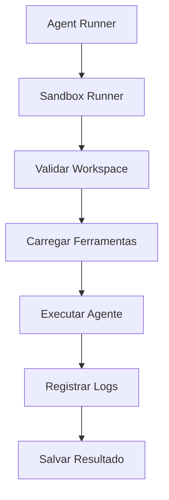

# Desafio 07 – Workspace Seguro e Introdução ao Sandbox Runner

## Visão Geral

Este módulo marca uma mudança importante na arquitetura da plataforma. Até este ponto, o agente já consegue interagir com LLMs, utilizar ferramentas e executar fluxos básicos.

Agora precisamos garantir que toda execução ocorra em um ambiente controlado, observável e seguro.

O objetivo deste desafio é introduzir os conceitos de:

- Workspace Seguro
- Sandbox Runner
- Isolamento de recursos
- Proteção contra acesso indevido
- Estrutura para homologação futura
- Base para Replay Engine

---

# Objetivos

Ao concluir este desafio você será capaz de:

1. Entender a diferença entre Workspace e Sandbox.
2. Criar uma arquitetura de execução isolada.
3. Impedir acesso fora do diretório permitido.
4. Estruturar áreas de logs, memória e saídas.
5. Preparar a plataforma para ferramentas simuladas.
6. Criar fundações para testes automatizados.
7. Entender como ambientes corporativos homologam agentes antes da produção.

---

# Conceitos Fundamentais

## O que é Workspace?

Workspace é a área autorizada para leitura e escrita do agente.

Tudo o que o agente produz deve permanecer dentro deste espaço.

Exemplos:

- Logs
- Memória
- Relatórios
- Arquivos temporários
- Resultados

## O que é Sandbox?

Sandbox é um ambiente controlado onde o agente acredita estar trabalhando em um ambiente real.

Porém:

- APIs são simuladas
- Bancos são simulados
- Ferramentas são simuladas
- Arquivos são simulados

Objetivo:

Permitir treinamento e validação sem riscos.

---

# Arquitetura Conceitual

```text
Agent Runner
      |
      v
Sandbox Runner
      |
      +---- Workspace
      |
      +---- Logs
      |
      +---- Memory
      |
      +---- Tools
```

---

# Estrutura de Diretórios

```text
ai-agent-platform/
|
+-- workspace/
|   +-- logs/
|   +-- memory/
|   +-- outputs/
|   +-- temp/
|   +-- sandbox/
|
+-- sandbox/
|   +-- files/
|   +-- fixtures/
|   +-- scenarios/
|   +-- replays/
|
+-- tools/
+-- config/
```

---

# Regras de Segurança

## Regra 1

Nunca acessar arquivos fora do workspace.

## Regra 2

Nunca permitir caminhos relativos perigosos.

Exemplo:

```text
../../../etc/passwd
```

Deve ser bloqueado.

## Regra 3

Toda operação deve passar por validação.

## Regra 4

Ferramentas não registradas não podem ser executadas.

---

# Sandbox Runner

## Responsabilidades

- Inicializar ambiente seguro
- Registrar contexto
- Carregar fixtures
- Resolver ferramentas
- Gerar logs
- Preparar observabilidade

## Não é responsabilidade

- Tomar decisões da IA
- Executar prompts
- Escolher modelos

Estas funções permanecem no Agent Runner.

---

# Fluxo de Execução



---

# Exercício 1

Criar toda a estrutura de diretórios do workspace.

Critério de aprovação:

- Estrutura criada
- Pastas documentadas
- Gitignore atualizado

---

# Exercício 2

Implementar função de validação de caminhos.

A função deve:

- aceitar caminhos válidos
- rejeitar caminhos externos
- registrar tentativas inválidas

---

# Exercício 3

Criar configuração:

```yaml
environment:
  mode: sandbox
```

Objetivo:

Preparar a futura alternância entre sandbox e produção.

---

# Exercício 4

Criar diretório:

```text
sandbox/scenarios/
```

Adicionar três cenários simulados.

Exemplos:

- incidente crítico
- falha de banco
- falha de API

---

# Armadilhas Comuns

## Erro 1

Confundir Workspace com Sandbox.

Workspace é armazenamento.

Sandbox é execução controlada.

## Erro 2

Permitir caminhos arbitrários.

## Erro 3

Misturar dados reais com dados simulados.

## Erro 4

Escrever logs fora do workspace.

---

# Critérios de Aprovação

Para concluir o desafio:

- Workspace criado
- Sandbox criado
- Estrutura documentada
- Validação de caminhos implementada
- Cenários simulados criados
- Configuração sandbox adicionada

---

# Perguntas de Revisão

1. Qual a diferença entre Workspace e Sandbox?
2. Por que um Sandbox reduz riscos?
3. O que é Path Traversal?
4. Por que validar todos os caminhos?
5. Qual o papel do Sandbox Runner?

---

# Relação com a Arquitetura Final

Este módulo estabelece as bases para:

- Desafio 08 – Tool Router
- Desafio 10 – LLM Factory
- Desafio 12 – Sandbox Runner completo
- Desafio 14 – Replay Engine
- Desafio 17 – Homologação

Sem este módulo não existe ambiente seguro para validar agentes antes da produção.

---

# Próximo Módulo

Desafio 08 – Tool Router com suporte a Sandbox Tools e Production Tools.
