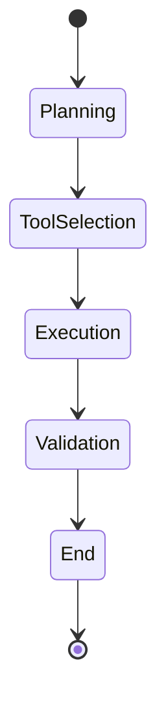
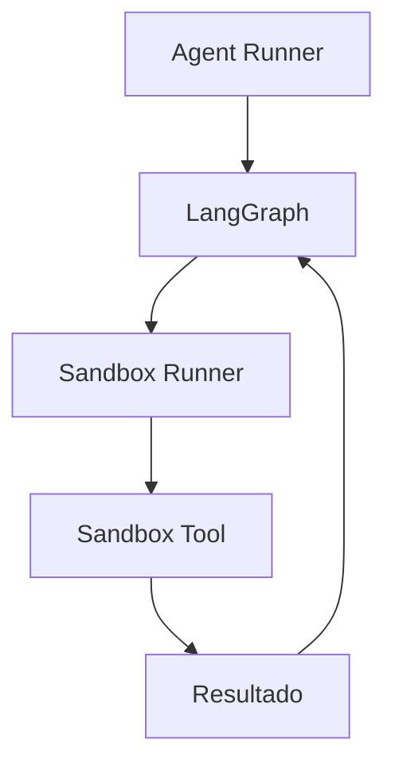

# Desafio 11 – LangGraph: Estados, Checkpoints e Orquestração de Fluxos (Versão Avançada)

## Visão Geral

Neste módulo a plataforma deixa de executar apenas fluxos lineares e passa a utilizar um mecanismo formal de orquestração baseado em estados.

O LangGraph será o núcleo responsável por controlar ciclos de raciocínio, decisões, checkpoints, retomadas de execução e futuras arquiteturas multiagentes.

---

# Objetivos

- Compreender os conceitos do LangGraph.
- Diferenciar LangChain Agents e LangGraph.
- Modelar estados.
- Implementar workflows orientados a grafos.
- Implementar checkpoints.
- Integrar Sandbox Runner.
- Integrar Replay Engine.
- Preparar arquitetura multiagente.

---

# Motivação Arquitetural

Problemas de agentes tradicionais:

- Fluxos implícitos.
- Baixa auditabilidade.
- Dificuldade de recuperação.
- Falta de persistência.
- Pouco controle de execução.

LangGraph resolve esses problemas através de estados explícitos.

---

# ADR-003

**Decisão:** Adotar LangGraph como mecanismo principal de orquestração.

**Motivação:** Controle determinístico do fluxo, suporte a checkpoints e evolução natural para múltiplos agentes.

---

# Conceitos Fundamentais

## Nó

Representa uma etapa do processo.

Exemplos:

- Planejamento
- Pesquisa
- Execução
- Revisão

## Aresta

Representa uma transição.

## Estado

Representa o contexto compartilhado entre os nós.

---

# Arquitetura Conceitual

```text
Start
 |
 v
Planner
 |
 v
Tool Selection
 |
 v
Execution
 |
 v
Validation
 |
 v
End
```

---

# Máquina de Estados



---

# Modelo de Estado

Campos mínimos:

```text
user_request
current_step
selected_tool
execution_result
errors
memory_context
```

---

# Checkpoints

## Objetivo

Permitir retomada de execução.

Casos:

- Falha de rede.
- Falha de ferramenta.
- Reinício da aplicação.

---

# Integração com Sandbox Runner

Fluxo:



---

# Integração com Replay Engine

Cada transição deverá gerar eventos.

Exemplo:

```json
{
  "state":"execution",
  "tool":"read_logs",
  "timestamp":""
}
```

---

# Integração com Memory Layer

Antes de cada execução:

1. Recuperar contexto relevante.
2. Atualizar estado.
3. Persistir alterações.

---

# Human in the Loop

Arquitetura futura:

```text
Planning
   |
   v
Approval Required
   |
   v
Execution
```

Usado para ações críticas.

---

# Casos de Uso Corporativos

## Caso 1

Investigação de incidente.

## Caso 2

Análise de documentação.

## Caso 3

Orquestração de múltiplas ferramentas.

## Caso 4

Coordenação de múltiplos agentes.

---

# Estrutura de Diretórios

```text
src/
├── graphs/
├── states/
├── checkpoints/
├── workflows/
└── transitions/
```

---

# Exercício 1

Modelar estado inicial.

---

# Exercício 2

Criar workflow com:

- Planning
- Execution
- Validation

---

# Exercício 3

Persistir checkpoints.

---

# Exercício 4

Integrar Sandbox Runner.

---

# Exercício Avançado

Implementar fluxo com aprovação humana.

---

# Observabilidade

Registrar:

- Estado atual.
- Próximo estado.
- Tempo de permanência.
- Ferramenta utilizada.
- Checkpoint criado.

---

# Testes

## Unitários

- Estados.
- Transições.

## Integração

- Fluxos completos.

## E2E

- Execução ponta a ponta.

---

# Critérios de Aprovação

- Workflow funcional.
- Estados persistidos.
- Checkpoints operacionais.
- Integração Sandbox validada.
- Logs produzidos.

---

# Armadilhas Comuns

1. Estados excessivamente grandes.
2. Persistência inadequada.
3. Loops infinitos.
4. Falta de observabilidade.

---

# Checklist

- Estados modelados.
- Workflow criado.
- Checkpoints persistidos.
- Replay compatível.
- Sandbox integrado.

---

# Perguntas de Revisão

1. O que diferencia LangGraph de um Agent tradicional?
2. O que é um checkpoint?
3. Como ocorre a persistência do estado?
4. Como integrar Replay Engine?
5. Como preparar múltiplos agentes?

---

# Relação com a Arquitetura Final

Este módulo conecta:

- LLM Factory
- Sandbox Runner
- Replay Engine
- Memory Layer
- Multiagentes

Ele representa a fundação da arquitetura corporativa final.

---

# Próximo Módulo

Desafio 12 – Sandbox Runner Completo, Governança, Telemetria e Segurança Operacional.
