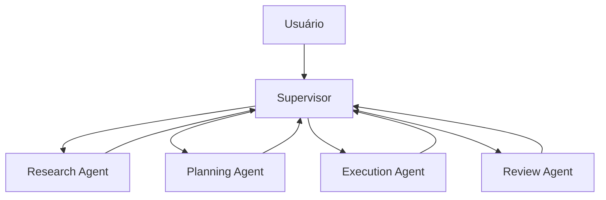
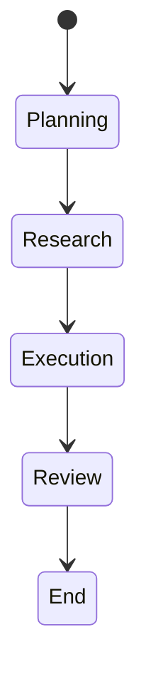

# Desafio 18 – Arquitetura Multiagentes Base

## Visão Geral

Até o Desafio 17 a plataforma foi construída para operar um único agente de maneira segura, observável e auditável.

A partir deste módulo inicia-se a segunda grande fase do projeto: a evolução para arquiteturas multiagentes.

O objetivo não é apenas executar vários agentes ao mesmo tempo.

O objetivo é construir um sistema no qual agentes especializados cooperem para resolver problemas complexos utilizando:

- LangGraph
- Sandbox Runner
- Replay Engine
- Memory Layer
- LLM Factory
- Benchmark Framework
- Observability Layer

---

# Objetivos de Aprendizagem

Ao concluir este desafio você será capaz de:

1. Entender os fundamentos de arquiteturas multiagentes.
2. Diferenciar agente único de ecossistema multiagente.
3. Modelar agentes especializados.
4. Projetar mecanismos de coordenação.
5. Projetar mecanismos de comunicação.
6. Definir responsabilidades por agente.
7. Preparar a plataforma para Supervisor Agents.

---

# Motivação Arquitetural

Problemas complexos raramente são resolvidos por um único especialista.

Exemplo corporativo:

Incidente crítico envolvendo:

- GPS
- Banco de dados
- Comunicação satelital
- Procedimentos operacionais

Um único agente tende a acumular responsabilidades.

Solução:

Especialização.

---

# ADR-010 – Arquitetura Multiagente

## Decisão

Adotar uma arquitetura baseada em agentes especializados.

## Motivação

- Escalabilidade funcional.
- Separação de responsabilidades.
- Melhor governança.
- Melhor observabilidade.
- Menor acoplamento.

## Consequências

- Necessidade de coordenação.
- Necessidade de protocolos.
- Necessidade de memória compartilhada.

---

# Conceitos Fundamentais

## Single Agent

```text
Usuário
   |
   v
Agent
```

Tudo ocorre em um único agente.

## Multiagent System

```text
Usuário
   |
   v
Supervisor
   |
   +-- Research Agent
   +-- Planning Agent
   +-- Execution Agent
   +-- Review Agent
```

---

# Princípio da Especialização

Cada agente deve possuir:

- Objetivo único.
- Ferramentas específicas.
- Métricas específicas.
- Contexto reduzido.

Anti-padrão:

```text
Mega Agent
```

Padrão recomendado:

```text
Multiple Specialized Agents
```

---

# Arquitetura Base



---

# Papéis dos Agentes

## Research Agent

Responsável por:

- Pesquisar informações.
- Consultar memória.
- Consultar documentos.

## Planning Agent

Responsável por:

- Definir estratégia.
- Quebrar tarefas.
- Criar plano.

## Execution Agent

Responsável por:

- Utilizar ferramentas.
- Executar ações.

## Review Agent

Responsável por:

- Validar resultados.
- Auditar respostas.

---

# Integração com LangGraph

O LangGraph torna-se o orquestrador.



---

# Integração com Sandbox Runner

Todos os agentes devem operar inicialmente em Sandbox.

Benefícios:

- Segurança.
- Benchmark.
- Replay.
- Homologação.

---

# Integração com Replay Engine

Cada agente deverá registrar:

- Prompt recebido.
- Decisões.
- Ferramentas.
- Resultado.

Exemplo:

```json
{
  "agent":"research_agent",
  "action":"vector_search"
}
```

---

# Integração com Memory Layer

Existem duas abordagens.

## Memória Privada

Cada agente possui memória própria.

## Memória Compartilhada

Todos os agentes acessam o mesmo contexto.

Arquitetura inicial:

```text
Shared Memory
```

---

# Modelo Operacional

```text
1. Usuário cria solicitação
2. Supervisor recebe
3. Supervisor delega
4. Agentes executam
5. Supervisor consolida
6. Resultado final retornado
```

---

# Casos de Uso Corporativos

## Caso 1 – Investigação de Incidente

Research Agent:

- consulta histórico

Planning Agent:

- define investigação

Execution Agent:

- consulta ferramentas

Review Agent:

- valida conclusão

---

## Caso 2 – Criação de Relatório

Pesquisa.

Planejamento.

Produção.

Revisão.

---

## Caso 3 – Suporte Operacional

Coordenação de agentes especializados por domínio.

---

# Estrutura de Diretórios

```text
multiagent/
├── supervisor/
├── agents/
│   ├── research/
│   ├── planning/
│   ├── execution/
│   └── review/
├── protocols/
├── memory/
└── orchestration/
```

---

# Requisitos Não Funcionais

- Escalabilidade.
- Observabilidade.
- Auditabilidade.
- Reprodutibilidade.
- Resiliência.

---

# Exercício 1

Modelar quatro agentes especializados.

Critérios:

- responsabilidades claramente definidas.

---

# Exercício 2

Desenhar workflow multiagente em Mermaid.

---

# Exercício 3

Definir responsabilidades do Supervisor.

---

# Exercício 4

Mapear integração com Sandbox Runner.

---

# Exercício Avançado

Projetar uma investigação completa de incidente usando quatro agentes especializados.

---

# Estratégia de Testes

## Unitários

- agentes individuais.

## Integração

- comunicação.

## E2E

- fluxo completo.

---

# Critérios de Aprovação

- Arquitetura multiagente definida.
- Papéis documentados.
- Workflow modelado.
- Integrações previstas.

---

# Armadilhas Comuns

1. Criar agentes genéricos demais.
2. Duplicar responsabilidades.
3. Compartilhar contexto em excesso.
4. Ignorar observabilidade.
5. Não utilizar supervisor.

---

# Checklist

- Especializações definidas.
- Fluxos definidos.
- Integrações documentadas.
- Casos de uso modelados.

---

# Perguntas de Revisão

1. Qual a principal vantagem da especialização?
2. Quando utilizar múltiplos agentes?
3. Qual o papel do Supervisor?
4. Como integrar Replay Engine?
5. Como LangGraph auxilia a coordenação?

---

# Relação com a Arquitetura Final

Este módulo inaugura a fase Multiagentes e serve de fundação para:

- Desafio 19 – Supervisor Agent
- Desafio 20 – Protocolos de Comunicação
- Desafio 21 – Memory Sharing
- Desafio 23 – Hierarchical Agents
- Desafio 24 – Collaborative Agents

---

# Próximo Módulo

Desafio 19 – Supervisor Agent, Coordenação, Delegação e Governança de Agentes Especializados.
