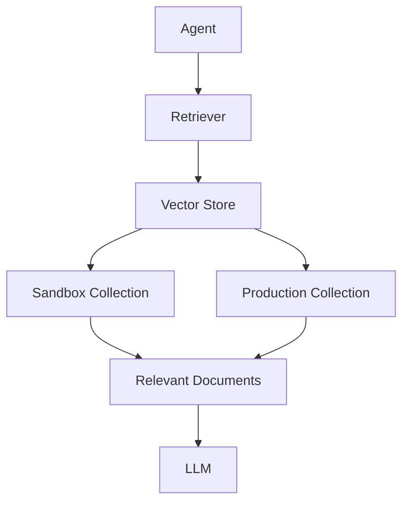

# Desafio 09 – Memória Vetorial para Sandbox e Produção

## Visão Geral

Até este ponto da trilha, a plataforma já possui:

- Workspace Seguro
- Sandbox Runner (fundações)
- Tool Router
- Separação entre ambientes

O próximo passo é resolver um problema fundamental dos agentes de IA: memória de longo prazo.

Neste módulo você implementará a primeira camada de memória vetorial da plataforma, preparando a arquitetura para:

- RAG (Retrieval Augmented Generation)
- Memória persistente
- Busca semântica
- Contexto compartilhado entre agentes
- Conhecimento corporativo
- Aprendizado baseado em documentos

---

# Objetivos de Aprendizagem

Ao concluir este desafio você será capaz de:

1. Entender a diferença entre memória tradicional e memória vetorial.
2. Compreender embeddings.
3. Entender como funciona busca semântica.
4. Implementar um Vector Store.
5. Separar memória Sandbox e Produção.
6. Preparar a plataforma para RAG.
7. Integrar memória vetorial ao ecossistema LangChain.

---

# Problema Arquitetural

LLMs não lembram de conversas anteriores depois que a execução termina.

Além disso:

- Possuem limite de contexto.
- Não armazenam conhecimento corporativo.
- Não possuem memória persistente nativa.

Precisamos de uma camada externa.

---

# Conceitos Fundamentais

## Memória Tradicional

Armazena dados por chave.

Exemplo:

```python
usuario["nome"]
```

Busca exata.

---

## Memória Vetorial

Armazena significado.

Exemplo:

Pergunta:

```text
Problemas de conexão GPS
```

Pode encontrar:

```text
Falha de comunicação Globalstar
```

Mesmo sem palavras idênticas.

---

## Embeddings

Embedding é uma representação numérica de um texto.

Fluxo:

```text
Texto
  |
  v
Modelo Embedding
  |
  v
Vetor Numérico
```

---

# Arquitetura da Memória

```text
Agent
   |
   v
Memory Service
   |
   +-- Sandbox Collection
   |
   +-- Production Collection
```

---

# Arquitetura Completa



---

# Tecnologias Avaliadas

## ChromaDB

Vantagens:

- Simples
- Local
- Excelente para aprendizado

## FAISS

Vantagens:

- Rápido
- Leve

## Qdrant

Vantagens:

- Produção
- Escalabilidade

---

# Escolha do Projeto

Fase inicial:

```text
ChromaDB
```

Fase corporativa:

```text
Qdrant
```

---

# Estrutura de Diretórios

```text
workspace/
├── memory/
│   ├── sandbox/
│   └── production/
```

---

# Integração com Sandbox

Cada ambiente possui sua própria coleção.

Sandbox:

```text
memory/sandbox/
```

Produção:

```text
memory/production/
```

Nunca misturar dados.

---

# Caso de Uso 1

Incidentes recorrentes.

O agente consulta incidentes passados antes de responder.

---

# Caso de Uso 2

Base de conhecimento operacional.

Documentos:

- Procedimentos
- Runbooks
- Troubleshooting

---

# Exercício 1

Instalar e configurar ChromaDB.

Critério:

- Base criada.
- Persistência funcionando.

---

# Exercício 2

Inserir documentos de teste.

Exemplos:

- Falha de GPS.
- Problemas de conectividade.
- Alarmes de equipamentos.

---

# Exercício 3

Executar busca semântica.

Objetivo:

Recuperar documentos relacionados.

---

# Exercício 4

Separar coleções:

- Sandbox
- Production

---

# Exercício Avançado

Implementar camada Retriever utilizando LangChain.

---

# Observabilidade

Registrar:

- consulta realizada
- documentos retornados
- tempo de busca
- coleção utilizada

---

# Critérios de Aprovação

- ChromaDB funcionando.
- Coleções separadas.
- Busca semântica operacional.
- Logs gerados.
- Integração inicial com LangChain.

---

# Armadilhas Comuns

## Erro 1

Misturar dados Sandbox e Produção.

## Erro 2

Usar memória vetorial como banco relacional.

## Erro 3

Armazenar documentos excessivamente grandes sem chunking.

---

# Checklist do Módulo

- Estrutura criada.
- Banco vetorial funcional.
- Dados persistidos.
- Busca semântica validada.
- Observabilidade implementada.

---

# Perguntas de Revisão

1. O que é um embedding?
2. O que diferencia busca semântica de busca textual?
3. Por que separar Sandbox e Produção?
4. Quando utilizar Qdrant em vez de ChromaDB?
5. Como a memória vetorial habilita RAG?

---

# Relação com a Arquitetura Final

Este módulo prepara a base para:

- Desafio 10 – LLM Factory
- Desafio 11 – LangGraph
- Desafio 14 – Replay Engine
- RAG Corporativo
- Multiagentes

---

# Próximo Módulo

Desafio 10 – LLM Factory, Failover e Mocks para Sandbox.
