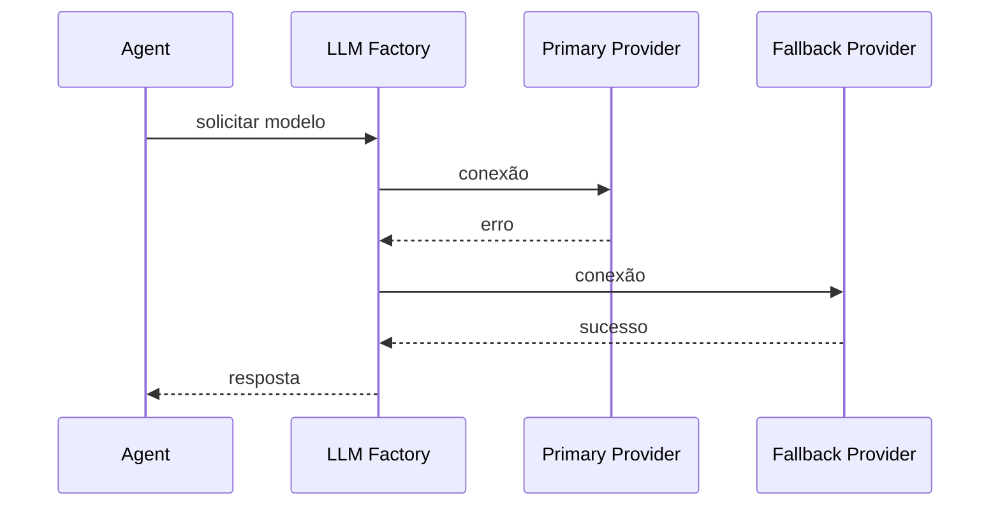

# Desafio 10 – LLM Factory, Failover e Mocks para Sandbox

## Visão Geral

Neste módulo construiremos a LLM Factory, componente responsável por abstrair provedores de modelos, criar instâncias de LLM dinamicamente, executar failover e suportar mocks para Sandbox.

## Objetivos

- Centralizar criação de LLMs.
- Separar agentes dos provedores.
- Implementar fallback automático.
- Suportar OpenAI, Anthropic e Google.
- Criar mocks para testes offline.
- Preparar benchmark automatizado.

## Problema Arquitetural

Sem uma fábrica de LLMs, cada componente conhece detalhes dos provedores, gerando acoplamento, dificuldade de manutenção e ausência de failover.

## ADR-001

**Decisão:** utilizar padrão Factory.

**Motivação:** desacoplamento e extensibilidade.

## ADR-002

**Decisão:** catálogo CSV de modelos.

**Motivação:** inclusão de novos provedores sem alteração de código.

## Arquitetura

```text
Agent
 |
 v
LLM Factory
 |
 +-- OpenAI
 +-- Anthropic
 +-- Google
 +-- Mock Provider
```

## Diagrama de Sequência



## Estrutura de Diretórios

```text
catalogs/
  llms.csv

src/
  llm_factory/
    providers/
    models/
    adapters/
```

## CSV de Catálogo

```csv
provider,model,api_key_env
openai,gpt-4o,OPENAI_API_KEY
anthropic,claude-sonnet-4,ANTHROPIC_API_KEY
google,gemini-2.5-pro,GEMINI_API_KEY
```

## YAML do Agente

```yaml
agent:
  primary:
    provider: openai
    model: gpt-4o
  fallback:
    provider: anthropic
    model: claude-sonnet-4
```

## Modo Sandbox

Criar Mock Provider:

- resposta determinística
- sem consumo de tokens
- sem chamadas externas
- reproduzível

## Casos de Uso

### Caso 1
Falha da OpenAI e troca automática para Anthropic.

### Caso 2
Execução completa usando Mock Provider em ambiente de testes.

### Caso 3
Benchmark comparando três provedores.

## Integração LangChain

A Factory deve retornar objetos compatíveis com LangChain para uso transparente pelos agentes.

## Observabilidade

Registrar:

- provider solicitado
- provider utilizado
- modelo utilizado
- tempo de resposta
- uso de fallback
- modo sandbox ou produção

## Exercícios

1. Construir catálogo CSV.
2. Implementar leitura do catálogo.
3. Criar abstração Provider.
4. Implementar OpenAI Provider.
5. Implementar Anthropic Provider.
6. Implementar Mock Provider.
7. Implementar failover.
8. Adicionar telemetria.

## Testes

- sucesso do provider primário
- falha do provider primário
- acionamento de fallback
- execução de mock
- validação do catálogo

## Critérios de Aprovação

- Factory funcional.
- Failover operacional.
- Mock Provider operacional.
- Integração LangChain validada.
- Logs produzidos.

## Armadilhas Comuns

- Acoplamento do agente ao provedor.
- Falta de timeout.
- Fallback sem auditoria.
- Mock divergente do comportamento real.

## Relação com Arquitetura Final

Este módulo viabiliza:

- Desafio 11 (LangGraph)
- Desafio 12 (Sandbox Runner Completo)
- Desafio 15 (Benchmark)
- Arquitetura multiagente.

## Próximo Módulo

Desafio 11 – LangGraph, Estados, Checkpoints e Orquestração de Fluxos.
