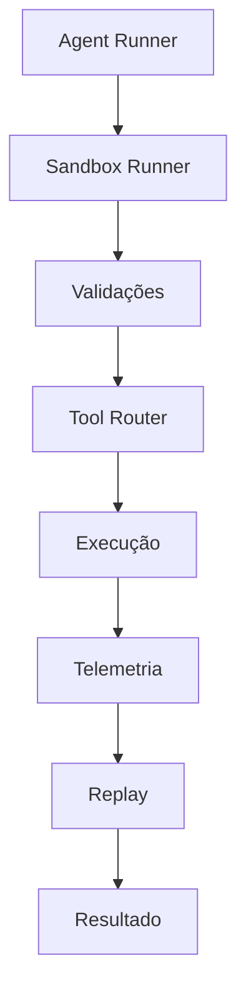
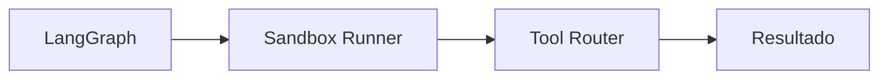

# Desafio 12 – Sandbox Runner Completo, Governança, Telemetria e Segurança Operacional

## Visão Geral

O Sandbox Runner é o componente central da plataforma. A partir deste módulo, toda execução do agente passa a ocorrer dentro de um ambiente controlado, observável, auditável e reproduzível.

Ele funciona como uma camada intermediária entre o Agent Runner e os recursos utilizados durante a execução.

Objetivos:

- Garantir segurança operacional.
- Permitir homologação segura.
- Possibilitar replay completo.
- Registrar telemetria.
- Controlar acesso a ferramentas.
- Isolar ambientes Sandbox e Produção.
- Fornecer governança corporativa.

---

# Objetivos de Aprendizagem

Ao concluir este desafio você será capaz de:

1. Projetar um Sandbox Runner corporativo.
2. Implementar controle de execução.
3. Integrar Tool Router.
4. Integrar LLM Factory.
5. Integrar LangGraph.
6. Implementar telemetria.
7. Implementar auditoria.
8. Definir políticas de governança.
9. Preparar homologação para produção.

---

# Problema Arquitetural

Sem um Sandbox Runner:

- Ferramentas podem executar ações indevidas.
- Ambientes de teste e produção podem se misturar.
- Não existe trilha de auditoria.
- Não existe replay.
- Falhas são difíceis de reproduzir.

O Sandbox Runner resolve esses problemas centralizando o controle operacional.

---

# ADR-004

## Decisão

Criar um Sandbox Runner independente.

## Motivação

Separar lógica de negócio da execução operacional.

## Benefícios

- Segurança.
- Observabilidade.
- Governança.
- Escalabilidade.

---

# Arquitetura Geral

```text
Agent Runner
      |
      v
Sandbox Runner
      |
      +-- Security Layer
      +-- Tool Router
      +-- LLM Factory
      +-- Replay Engine
      +-- Memory Layer
      +-- Metrics Layer
      +-- LangGraph Runtime
```

---

# Arquitetura em Camadas

## Camada 1 – Agent Runner

Responsável por:

- Inicialização.
- Configuração.
- Objetivos do agente.

## Camada 2 – Sandbox Runner

Responsável por:

- Governança.
- Controle.
- Auditoria.

## Camada 3 – Recursos

- Ferramentas.
- Memória.
- LLMs.
- Workflows.

---

# Modos de Execução

## Sandbox

```yaml
environment:
  mode: sandbox
```

Características:

- APIs simuladas.
- Bancos simulados.
- Ferramentas simuladas.
- Zero impacto externo.

## Produção

```yaml
environment:
  mode: production
```

Características:

- Ferramentas reais.
- APIs reais.
- Auditoria obrigatória.

---

# Fluxo de Execução



---

# Security Layer

## Objetivos

Impedir:

- Path Traversal.
- Ferramentas não autorizadas.
- Prompt Injection operacional.
- Execuções fora do escopo.

## Validações

### Validação de Workspace

Tudo deve permanecer dentro de:

```text
workspace/
```

### Validação de Ferramentas

Somente ferramentas registradas.

### Validação de Tempo

Tempo máximo configurado.

### Validação de Iterações

Número máximo de ciclos.

---

# Tool Governance

Cada ferramenta deve possuir metadados.

Exemplo:

```yaml
name: create_ticket
mode:
  - sandbox
  - production
risk_level: medium
approval_required: false
```

---

# Telemetria

## Métricas Obrigatórias

- Timestamp.
- Duração.
- Modelo.
- Provider.
- Ferramentas.
- Tokens entrada.
- Tokens saída.
- Tokens totais.
- Falhas.

---

# Observabilidade

Formato JSONL.

Exemplo:

```json
{
  "provider": "openai",
  "model": "gpt-4o",
  "execution_time": 1.25
}
```

---

# Replay Engine Integration

Toda transição deve gerar eventos.

Campos mínimos:

```json
{
 "execution_id":"",
 "timestamp":"",
 "tool":"",
 "state":""
}
```

---

# Integração com Memory Layer

Fluxo:

1. Recuperar contexto.
2. Executar workflow.
3. Persistir memória.
4. Atualizar vetores.

---

# Integração com LLM Factory

Responsabilidades:

- Escolha do provider.
- Failover.
- Telemetria.

Sandbox Runner não cria modelos diretamente.

---

# Integração com LangGraph

O LangGraph executa workflows.

O Sandbox Runner controla a execução.



---

# Casos de Uso Corporativos

## Caso 1 – Investigação de Incidente

Executado inteiramente em Sandbox.

## Caso 2 – Benchmark de Modelos

Múltiplos modelos executando o mesmo cenário.

## Caso 3 – Homologação

Execução controlada antes da promoção.

## Caso 4 – Multiagentes

Supervisor monitorando agentes especializados.

---

# Estrutura de Diretórios

```text
sandbox/
├── scenarios/
├── fixtures/
├── replays/
├── telemetry/
└── reports/
```

---

# Exercício 1

Criar Sandbox Runner básico.

Critério:

Inicializar corretamente o ambiente.

---

# Exercício 2

Implementar Security Layer.

---

# Exercício 3

Implementar Telemetry Layer.

---

# Exercício 4

Adicionar suporte ao Replay Engine.

---

# Exercício 5

Integrar Tool Router.

---

# Exercício Avançado

Executar benchmark completo em Sandbox.

---

# Estratégia de Testes

## Unitários

- Segurança.
- Telemetria.
- Configuração.

## Integração

- Tool Router.
- LLM Factory.
- Replay.

## E2E

Execução completa de agente.

---

# Critérios de Aprovação

- Sandbox Runner operacional.
- Tool Router integrado.
- Replay integrado.
- Logs produzidos.
- Telemetria produzida.
- Testes aprovados.

---

# Armadilhas Comuns

1. Misturar responsabilidades.
2. Permitir bypass de segurança.
3. Ignorar observabilidade.
4. Não registrar telemetria.
5. Acoplamento excessivo.

---

# Checklist do Módulo

- Ambiente isolado.
- Segurança implementada.
- Telemetria implementada.
- Replay integrado.
- LangGraph integrado.
- LLM Factory integrada.

---

# Perguntas de Revisão

1. Qual o papel do Sandbox Runner?
2. Qual a diferença entre Agent Runner e Sandbox Runner?
3. Como funciona a telemetria?
4. Como ocorre a integração com LangGraph?
5. Quais benefícios do Replay Engine?

---

# Relação com a Arquitetura Final

O Sandbox Runner torna-se o núcleo operacional da plataforma.

Todos os componentes futuros dependerão dele.

---

# Próximo Módulo

Desafio 13 – Ferramentas Simuladas, Mock Services e Ambientes de Homologação.
