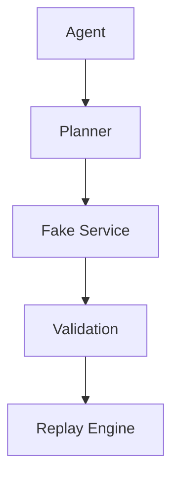

# Desafio 13 – Ferramentas Simuladas, Mock Services e Ambientes de Homologação

## Visão Geral

Após a construção do Sandbox Runner, o próximo passo é criar um ecossistema completo de serviços simulados que permita executar, validar, homologar e evoluir agentes sem dependência de sistemas corporativos reais.

Este módulo define a arquitetura dos Mock Services da plataforma.

---

# Objetivos de Aprendizagem

Ao concluir este desafio você será capaz de:

1. Projetar ferramentas simuladas corporativas.
2. Construir ambientes de homologação seguros.
3. Simular integrações empresariais.
4. Executar testes reproduzíveis.
5. Separar contratos de API da implementação.
6. Preparar benchmark e replay.
7. Suportar desenvolvimento offline.

---

# Motivação Arquitetural

Em ambientes corporativos não é aceitável que um agente em desenvolvimento:

- Crie tickets reais.
- Envie e-mails reais.
- Atualize SharePoint.
- Consulte bancos produtivos.
- Acione APIs externas críticas.

Para resolver esse problema introduzimos Mock Services.

---

# ADR-005

## Decisão

Toda integração corporativa deverá possuir uma implementação simulada.

## Benefícios

- Segurança
- Reprodutibilidade
- Menor custo
- Homologação simplificada
- Testes automatizados

---

# Arquitetura Geral

```text
Agent
 |
 v
Sandbox Runner
 |
 +-- Fake Jira
 +-- Fake ServiceNow
 +-- Fake SharePoint
 +-- Fake Database
 +-- Fake Email
 +-- Fake REST APIs
```

---

# Princípio de Compatibilidade

Toda ferramenta simulada deve implementar exatamente o mesmo contrato da ferramenta real.

```text
CreateTicketTool
    |
    +-- RealCreateTicketTool
    +-- FakeCreateTicketTool
```

---

# Catálogo de Serviços Simulados

## Fake Jira

Funcionalidades:

- criar ticket
- atualizar ticket
- consultar ticket
- fechar ticket

Campos:

- id
- summary
- description
- status

---

## Fake ServiceNow

Funcionalidades:

- incidentes
- mudanças
- requisições

---

## Fake SharePoint

Funcionalidades:

- upload
- download
- pesquisa
- versionamento

---

## Fake Database

Implementação inicial:

- SQLite

Implementação futura:

- PostgreSQL Docker

---

## Fake Email

Objetivos:

- capturar mensagens
- validar templates
- impedir envio real

---

## Fake HTTP APIs

Objetivo:

Simular APIs externas.

Casos:

- GPS
- IoT
- ERP
- CRM

---

# Estrutura de Diretórios

```text
sandbox/
├── services/
│   ├── jira/
│   ├── servicenow/
│   ├── sharepoint/
│   ├── database/
│   ├── email/
│   └── apis/
│
├── fixtures/
├── scenarios/
└── replays/
```

---

# Arquitetura de Fixtures

Fixtures representam dados de teste.

Exemplo:

```text
fixtures/
├── incidents.json
├── tickets.json
├── assets.json
└── users.json
```

---

# Arquitetura de Cenários

## Cenário 1

Queda de banco de dados.

## Cenário 2

Falha de GPS.

## Cenário 3

Incidente crítico.

## Cenário 4

Escalada operacional.

---

# Integração com Replay Engine

Cada interação deve gerar eventos.

```json
{
  "service":"fake_jira",
  "operation":"create_ticket",
  "result":"success"
}
```

---

# Integração com LangGraph

Workflow:



---

# Observabilidade

Registrar:

- serviço utilizado
- operação
- duração
- erros
- cenário
- ambiente

---

# Casos de Uso Corporativos

## Investigação de Incidente

Consulta Fake Jira.

## Gestão de Mudanças

Consulta Fake ServiceNow.

## Operações de Campo

Consulta Fake GPS API.

## Documentação

Consulta Fake SharePoint.

---

# Exercício 1

Construir Fake Jira.

Critérios:

- CRUD funcional.
- Persistência local.

---

# Exercício 2

Construir Fake ServiceNow.

---

# Exercício 3

Criar catálogo de cenários.

---

# Exercício 4

Implementar fixtures reutilizáveis.

---

# Exercício 5

Integrar Replay Engine.

---

# Exercício Avançado

Executar um fluxo LangGraph completo usando apenas serviços simulados.

---

# Estratégia de Testes

## Unitários

- serviços
- fixtures
- validações

## Integração

- Sandbox Runner
- Replay Engine
- Tool Router

## E2E

Cenários corporativos completos.

---

# Requisitos Não Funcionais

- Reproduzibilidade
- Baixo custo
- Execução offline
- Auditoria completa
- Compatibilidade com produção

---

# Critérios de Aprovação

- Fake Jira operacional
- Fake ServiceNow operacional
- Fixtures criadas
- Cenários definidos
- Logs gerados
- Replay funcional

---

# Armadilhas Comuns

1. Criar mocks simplificados demais.
2. Divergir contrato entre ambiente real e simulado.
3. Não registrar telemetria.
4. Não versionar fixtures.
5. Não automatizar cenários.

---

# Checklist do Módulo

- Serviços simulados definidos.
- Catálogo de cenários criado.
- Fixtures criadas.
- Integração com Sandbox Runner.
- Integração com Replay Engine.

---

# Perguntas de Revisão

1. Por que utilizar serviços simulados?
2. O que diferencia mock de fixture?
3. Como garantir compatibilidade com produção?
4. Como integrar LangGraph aos mocks?
5. Como os cenários suportam homologação?

---

# Relação com a Arquitetura Final

Este módulo estabelece a fundação dos ambientes de homologação da plataforma.

Todos os benchmarks, replays, testes E2E e validações corporativas dependerão das ferramentas simuladas implementadas aqui.

---

# Próximo Módulo

Desafio 14 – Replay Engine, Auditoria Completa e Reprodutibilidade de Execuções.
