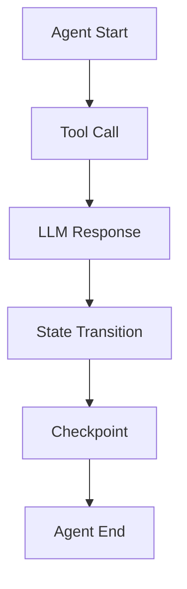
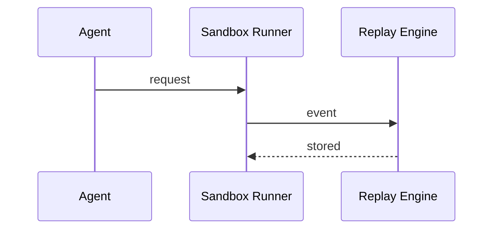

# Desafio 14 – Replay Engine, Auditoria Completa e Reprodutibilidade de Execuções

## Visão Geral

O Replay Engine é um dos componentes mais importantes da plataforma.

Ele permite reconstruir exatamente o que ocorreu durante uma execução de agente, incluindo:

- Prompt recebido
- Estado do workflow
- Ferramentas utilizadas
- Respostas da LLM
- Transições do LangGraph
- Eventos do Sandbox Runner
- Métricas e telemetria

Seu objetivo principal é garantir rastreabilidade, auditoria, benchmarking e reprodutibilidade.

---

# Objetivos de Aprendizagem

1. Projetar um Replay Engine corporativo.
2. Implementar captura de eventos.
3. Entender event sourcing.
4. Criar auditoria completa.
5. Reexecutar execuções históricas.
6. Comparar resultados entre LLMs.
7. Integrar Sandbox Runner, LangGraph e Observabilidade.

---

# Problema Arquitetural

Sem um Replay Engine:

- Erros são difíceis de reproduzir.
- Não existe trilha de auditoria.
- Benchmarks não são confiáveis.
- Não é possível comparar modelos.
- Falhas intermitentes são difíceis de investigar.

---

# ADR-006 – Event Sourcing para Execuções

## Decisão

Armazenar toda execução como sequência de eventos.

## Benefícios

- Auditoria.
- Debug avançado.
- Benchmark.
- Comparação de modelos.
- Reprocessamento.

---

# Conceitos Fundamentais

## Replay

Capacidade de reproduzir uma execução passada.

## Event Log

Registro cronológico dos eventos.

## Session Trace

Conjunto completo de eventos de uma execução.

## Determinismo

Capacidade de reproduzir comportamento equivalente.

---

# Arquitetura Geral

```text
Agent Runner
      |
      v
Sandbox Runner
      |
      v
Replay Engine
      |
      +-- Event Store
      +-- Trace Store
      +-- Metrics Store
      +-- Replay Executor
```

---

# Arquitetura de Eventos



---

# Modelo de Evento

```json
{
  "execution_id": "",
  "timestamp": "",
  "event_type": "tool_call",
  "payload": {}
}
```

Campos obrigatórios:

- execution_id
- timestamp
- event_type
- payload
- source_component

---

# Categorias de Eventos

## Agent Events

- start
- stop
- failure

## Tool Events

- request
- response
- timeout

## LLM Events

- prompt
- completion
- fallback

## LangGraph Events

- state_enter
- state_exit
- transition

## Security Events

- denied_tool
- denied_path
- policy_violation

---

# Estrutura de Diretórios

```text
workspace/
├── replays/
│   ├── executions/
│   ├── traces/
│   ├── metrics/
│   └── exports/
```

---

# Integração com Sandbox Runner

Todo evento operacional deve ser capturado.



---

# Integração com LangGraph

Registrar:

- estado atual
- próximo estado
- duração
- erros

Objetivo:

Reconstruir visualmente o workflow executado.

---

# Integração com LLM Factory

Registrar:

- provider
- model
- temperatura
- fallback
- tokens

Exemplo:

```json
{
  "provider":"openai",
  "model":"gpt-4o"
}
```

---

# Integração com Observabilidade

Métricas capturadas:

- latência
- custo estimado
- uso de memória
- duração
- falhas

---

# Replay Executor

Responsável por:

1. Ler execução.
2. Reconstruir estado.
3. Reexecutar fluxo.
4. Comparar resultados.

---

# Casos de Uso Corporativos

## Caso 1 – Investigação de Incidente

Reexecutar uma falha reportada pelo usuário.

## Caso 2 – Benchmark

Executar o mesmo cenário em GPT-4o, Claude Sonnet e Gemini.

## Caso 3 – Auditoria

Demonstrar exatamente quais decisões foram tomadas.

## Caso 4 – Compliance

Armazenar trilha para inspeção posterior.

---

# Exportação

Formatos:

- JSON
- JSONL
- Markdown
- CSV

---

# Exercício 1

Implementar Event Store.

## Critérios

- Persistência funcional.
- Identificador único por execução.

---

# Exercício 2

Registrar eventos de ferramentas.

---

# Exercício 3

Registrar eventos do LangGraph.

---

# Exercício 4

Implementar Replay Executor.

---

# Exercício 5

Gerar relatório consolidado.

---

# Exercício Avançado

Comparar a mesma execução entre múltiplos modelos e gerar relatório de diferenças.

---

# Estratégia de Testes

## Unitários

- Event Store
- Replay Executor

## Integração

- Sandbox Runner
- LangGraph
- LLM Factory

## E2E

- Replay completo de execução histórica.

---

# Requisitos Não Funcionais

- Imutabilidade dos eventos.
- Baixa latência.
- Escalabilidade.
- Auditabilidade.
- Reprodutibilidade.

---

# Critérios de Aprovação

- Eventos persistidos.
- Replay funcional.
- Integração completa.
- Relatórios gerados.
- Testes aprovados.

---

# Armadilhas Comuns

1. Armazenar apenas logs em vez de eventos.
2. Não versionar esquema dos eventos.
3. Omitir transições do LangGraph.
4. Não capturar métricas.
5. Misturar traces de diferentes execuções.

---

# Checklist do Módulo

- Event Store criado.
- Trace Store criado.
- Replay Executor implementado.
- Integração com Sandbox Runner.
- Integração com LangGraph.
- Integração com LLM Factory.

---

# Perguntas de Revisão

1. O que diferencia Replay Engine de logging?
2. Como funciona Event Sourcing?
3. O que deve ser armazenado em um trace?
4. Como comparar execuções entre modelos?
5. Como o Replay Engine apoia auditoria e compliance?

---

# Relação com a Arquitetura Final

O Replay Engine é a base para:

- Benchmark de LLMs
- Auditoria corporativa
- Observabilidade avançada
- Homologação
- Multiagentes
- Compliance

Sem ele não existe rastreabilidade completa da plataforma.

---

# Próximo Módulo

Desafio 15 – Benchmark Framework, Avaliação de Modelos e Comparação Automatizada de LLMs.
