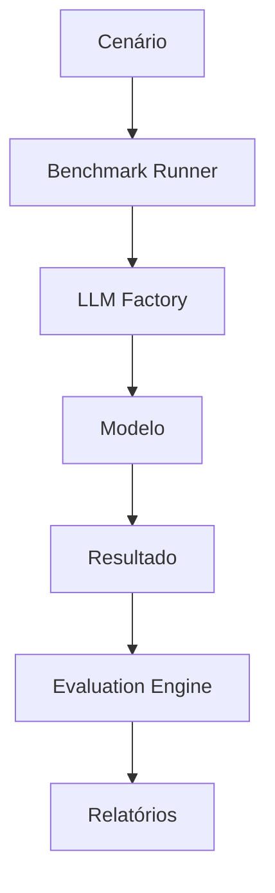

# Desafio 15 – Benchmark Framework, Avaliação de Modelos e Comparação Automatizada de LLMs

## Visão Geral

Após a implementação da LLM Factory, Sandbox Runner e Replay Engine, a plataforma está pronta para medir, comparar e validar modelos de linguagem de forma científica e reproduzível.

O Benchmark Framework será responsável por responder perguntas críticas:

- Qual modelo apresenta melhor qualidade?
- Qual possui menor latência?
- Qual apresenta melhor custo-benefício?
- Qual modelo deve ser utilizado como principal?
- Quando o fallback deve ser acionado?
- Como validar novos modelos antes de produção?

---

# Objetivos de Aprendizagem

1. Construir um framework de benchmark corporativo.
2. Medir desempenho de múltiplos provedores.
3. Avaliar qualidade das respostas.
4. Comparar latência e custo.
5. Integrar Replay Engine.
6. Executar benchmarks reproduzíveis.
7. Criar critérios de seleção de modelos.

---

# ADR-007 – Avaliação Padronizada de Modelos

## Decisão

Toda LLM deverá passar por benchmark antes de entrar em produção.

## Benefícios

- Redução de custos.
- Melhor previsibilidade.
- Failover embasado por dados.
- Governança técnica.

---

# Arquitetura do Benchmark Framework

```text
Benchmark Runner
      |
      +-- Scenario Catalog
      +-- LLM Factory
      +-- Replay Engine
      +-- Evaluation Engine
      +-- Report Generator
```

## Fluxo Geral



---

# Catálogo de Cenários

## Categoria 1 – Conhecimento Geral

Objetivo:

Medir conhecimento amplo.

## Categoria 2 – Operações

Objetivo:

Avaliar incidentes, troubleshooting e análise operacional.

## Categoria 3 – Uso de Ferramentas

Objetivo:

Avaliar Tool Calling.

## Categoria 4 – Raciocínio

Objetivo:

Mensurar desempenho lógico.

## Categoria 5 – Documentação

Objetivo:

Avaliar síntese e extração.

---

# Estrutura dos Cenários

```yaml
scenario:
  id: gps_incident_001
  category: operations
  expected_outcome: >
      Identificar falha de conectividade.
```

---

# Métricas Obrigatórias

## Latência

Tempo total da resposta.

## Disponibilidade

Taxa de sucesso.

## Tokens

- Entrada
- Saída
- Total

## Custo Estimado

Baseado na tabela do provedor.

## Qualidade

Pontuação definida pelo Evaluation Engine.

---

# Evaluation Engine

## Critérios

- Precisão
- Completude
- Consistência
- Aderência às instruções
- Segurança

Pontuação:

```text
0 a 100
```

---

# Integração com Replay Engine

Cada benchmark deve gerar replay completo.

Benefícios:

- Auditoria
- Comparação histórica
- Reprodutibilidade

---

# Integração com Sandbox Runner

Todos os benchmarks devem executar inicialmente em Sandbox.

```yaml
environment:
  mode: sandbox
```

---

# Integração com LLM Factory

Modelos suportados:

- OpenAI GPT-4o
- OpenAI GPT-4.1
- Anthropic Claude Sonnet
- Google Gemini

E futuros provedores.

---

# Benchmark de Fallback

Executar:

1. Modelo principal.
2. Simulação de falha.
3. Fallback automático.
4. Comparação dos resultados.

---

# Relatórios

## CSV

```text
workspace/outputs/llm_benchmark.csv
```

## Markdown

```text
workspace/outputs/llm_benchmark_report.md
```

## Ranking

```text
1. Modelo A
2. Modelo B
3. Modelo C
```

---

# Observabilidade

Registrar:

- provider
- model
- cenário
- duração
- custo
- score
- fallback

---

# Casos de Uso Corporativos

## Seleção de Modelo Principal

Identificar o melhor modelo para produção.

## Validação de Upgrade

Comparar versões de modelo.

## Redução de Custos

Encontrar modelos mais econômicos.

## Homologação

Promover modelos conforme métricas.

---

# Estrutura de Diretórios

```text
benchmark/
├── scenarios/
├── runners/
├── evaluators/
├── reports/
└── exports/
```

---

# Exercício 1

Criar catálogo de cenários.

## Critério

Mínimo de 20 cenários.

---

# Exercício 2

Implementar Benchmark Runner.

---

# Exercício 3

Implementar Evaluation Engine.

---

# Exercício 4

Gerar ranking automático.

---

# Exercício 5

Gerar relatório markdown.

---

# Exercício Avançado

Executar o mesmo benchmark em três provedores diferentes e produzir análise comparativa.

---

# Estratégia de Testes

## Unitários

- Cenários
- Avaliadores

## Integração

- LLM Factory
- Replay Engine
- Sandbox Runner

## E2E

Benchmark completo.

---

# Requisitos Não Funcionais

- Reprodutibilidade.
- Auditabilidade.
- Baixo acoplamento.
- Escalabilidade.
- Comparabilidade.

---

# Critérios de Aprovação

- Benchmark Runner funcional.
- Relatórios gerados.
- Ranking produzido.
- Integração completa.
- Testes aprovados.

---

# Armadilhas Comuns

1. Comparar modelos com cenários diferentes.
2. Ignorar latência.
3. Ignorar custo.
4. Não registrar replays.
5. Não controlar temperatura.

---

# Checklist do Módulo

- Catálogo criado.
- Métricas implementadas.
- Evaluation Engine criado.
- Relatórios produzidos.
- Replay integrado.

---

# Perguntas de Revisão

1. Como medir qualidade de uma LLM?
2. Qual a diferença entre benchmark e teste funcional?
3. Como comparar modelos de forma justa?
4. Por que integrar Replay Engine?
5. Como selecionar um modelo principal?

---

# Relação com a Arquitetura Final

O Benchmark Framework será utilizado para:

- Seleção de modelos.
- Definição de fallback.
- Homologação.
- Governança de IA.
- Evolução contínua da plataforma.

---

# Próximo Módulo

Desafio 16 – Framework de Testes Automatizados, Qualidade e Validação Contínua.
