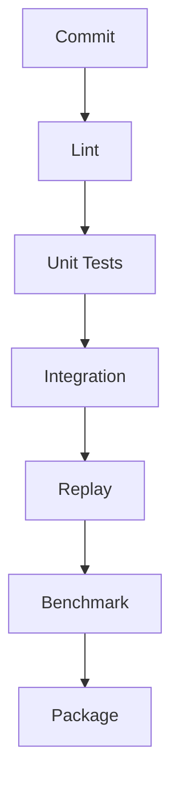

# Desafio 16 – Framework de Testes Automatizados, Qualidade, CI/CD e Validação Contínua

## Visão Geral

Com a implementação do Sandbox Runner, Replay Engine e Benchmark Framework, a plataforma já possui os componentes necessários para operação controlada. O próximo passo é garantir qualidade contínua através de testes automatizados e pipelines de validação.

Este módulo estabelece a estratégia de qualidade da plataforma.

---

# Objetivos de Aprendizagem

1. Construir uma estratégia corporativa de testes.
2. Implementar testes unitários, integração e E2E.
3. Integrar CI/CD.
4. Automatizar validações de arquitetura.
5. Utilizar Replay Engine para regressão.
6. Medir cobertura.
7. Criar critérios de promoção para homologação.

---

# ADR-008 – Quality Gates Obrigatórios

## Decisão

Nenhuma alteração poderá ser promovida sem validação automática.

## Benefícios

- Redução de defeitos.
- Menor custo de manutenção.
- Confiabilidade.
- Segurança operacional.

---

# Pirâmide de Testes

```text
            E2E
           /         Integração
       /             Unitários
```

Meta inicial:

- Unitários: 70%
- Integração: 20%
- E2E: 10%

---

# Arquitetura de Qualidade

```text
Source Code
     |
     v
Static Analysis
     |
     v
Unit Tests
     |
     v
Integration Tests
     |
     v
Sandbox Validation
     |
     v
Replay Regression
     |
     v
E2E Tests
```

---

# Estrutura de Diretórios

```text
tests/
├── unit/
├── integration/
├── e2e/
├── replay/
├── benchmark/
└── fixtures/
```

---

# Ferramentas Recomendadas

## Pytest

Framework principal de testes.

## Coverage.py

Cobertura de código.

Meta:

```text
80%+
```

## Ruff

Linting.

## MyPy

Validação de tipos.

## Pre-commit

Validação local.

---

# Testes Unitários

Validar componentes isolados:

- Tool Router
- LLM Factory
- Sandbox Runner
- Replay Engine
- Memory Layer

---

# Testes de Integração

Validar comunicação entre componentes.

Exemplos:

- Sandbox Runner + Tool Router
- LangGraph + Replay Engine
- LLM Factory + Benchmark

---

# Testes End-to-End

Executar cenários completos.

Exemplo:

1. Receber incidente.
2. Consultar memória.
3. Executar ferramenta.
4. Produzir resposta.
5. Registrar replay.

---

# Replay Regression Testing

Cada release deve reexecutar cenários históricos.

Objetivo:

Detectar regressões.

---

# Integração com Benchmark

Antes de promover uma versão:

- Executar benchmark.
- Comparar métricas históricas.
- Avaliar degradação.

---

# Quality Gates

## Gate 1

Lint aprovado.

## Gate 2

Tipos aprovados.

## Gate 3

Testes unitários.

## Gate 4

Integração.

## Gate 5

Replay.

## Gate 6

Benchmark.

---

# Pipeline CI/CD



---

# Observabilidade da Qualidade

Registrar:

- cobertura
- taxa de falha
- tempo médio dos testes
- regressões
- benchmark score

---

# Casos de Uso Corporativos

## Caso 1

Atualização de modelo GPT.

## Caso 2

Nova ferramenta integrada.

## Caso 3

Migração de banco vetorial.

---

# Exercícios

1. Configurar Pytest.
2. Criar primeiros testes unitários.
3. Criar suíte de integração.
4. Implementar replay regression.
5. Configurar pipeline CI.

---

# Exercício Avançado

Criar pipeline completo capaz de bloquear deploy quando houver regressão funcional ou degradação acima de 10% em benchmark.

---

# Requisitos Não Funcionais

- Execução automática.
- Reprodutibilidade.
- Baixo tempo de feedback.
- Cobertura mínima de 80%.

---

# Critérios de Aprovação

- Framework de testes funcional.
- Pipeline CI configurado.
- Replay Regression funcional.
- Benchmark integrado.
- Cobertura superior a 80%.

---

# Checklist do Módulo

- Pytest configurado.
- Coverage ativo.
- Ruff ativo.
- MyPy ativo.
- Pipeline criado.
- Quality Gates implementados.

---

# Perguntas de Revisão

1. O que diferencia testes unitários, integração e E2E?
2. Por que Replay Regression é importante?
3. Quando um deploy deve ser bloqueado?
4. Como benchmark complementa testes?
5. Qual o papel dos Quality Gates?

---

# Relação com a Arquitetura Final

Este módulo garante que toda evolução da plataforma seja validada antes da homologação e produção.

---

# Próximo Módulo

Desafio 17 – Homologação, Promotion Pipeline, Governança e Operação em Produção.
