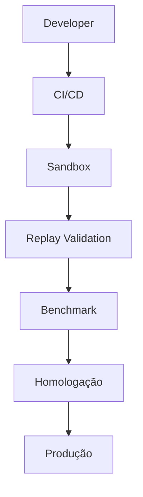

# Desafio 17 – Homologação, Promotion Pipeline, Governança e Operação em Produção

## Visão Geral

Este módulo conclui a jornada iniciada com o Sandbox Runner e estabelece o processo oficial de promoção de agentes para ambientes produtivos.

O objetivo central é garantir que nenhuma mudança chegue à produção sem passar por validações técnicas, operacionais, funcionais e de governança.

Neste ponto da arquitetura, a plataforma já possui:

- Workspace Seguro
- Tool Router
- Memória Vetorial
- LLM Factory
- LangGraph
- Sandbox Runner
- Mock Services
- Replay Engine
- Benchmark Framework
- Quality Gates

Agora será criado o processo corporativo de homologação.

---

# Objetivos de Aprendizagem

1. Construir um processo de homologação corporativa.
2. Definir Promotion Pipeline.
3. Implementar critérios de liberação.
4. Criar governança operacional.
5. Controlar riscos de produção.
6. Definir rollback e contingência.
7. Preparar a plataforma para operação contínua.

---

# ADR-009 – Promotion Pipeline Obrigatório

## Decisão

Toda alteração deverá passar por estágios formais antes da produção.

## Benefícios

- Redução de incidentes.
- Auditoria completa.
- Rastreabilidade.
- Conformidade.
- Operação previsível.

---

# Fluxo de Promoção

```text
Desenvolvimento
      |
      v
Sandbox
      |
      v
Replay Validation
      |
      v
Benchmark
      |
      v
Homologação
      |
      v
Produção
```

---

# Arquitetura Operacional



---

# Ambientes

## Desenvolvimento

Objetivo:

- Construção.
- Testes rápidos.

## Sandbox

Objetivo:

- Simulação controlada.
- Mock Services.

## Homologação

Objetivo:

- Cenários realistas.
- Aprovação operacional.

## Produção

Objetivo:

- Operação real.

---

# Critérios de Promoção

## Gate 1

Quality Gates aprovados.

## Gate 2

Replay Regression aprovado.

## Gate 3

Benchmark aprovado.

## Gate 4

Validação de Segurança.

## Gate 5

Aprovação operacional.

---

# Governança

Toda promoção deve registrar:

- versão
- responsável
- data
- modelo utilizado
- benchmark utilizado
- resultado dos testes

---

# Catálogo de Releases

```yaml
release:
  version: 1.0.0
  owner: platform-team
  approved: true
```

---

# Estratégia de Rollback

Objetivo:

Retornar rapidamente para versão anterior.

Critérios:

- aumento de erros
- degradação de benchmark
- falhas operacionais

---

# Observabilidade em Produção

Monitorar:

- Latência
- Falhas
- Uso de fallback
- Custos
- Tokens
- Ferramentas utilizadas

---

# Integração com Replay Engine

Toda execução produtiva deve gerar trilha auditável.

Benefícios:

- Compliance
- Investigação
- Benchmark contínuo

---

# Integração com Benchmark

Executar benchmark periódico.

Objetivo:

Detectar degradações.

---

# Integração com LangGraph

Registrar:

- workflow executado
- estados
- checkpoints
- falhas

---

# Operação Multiagente

Preparação para:

```text
Supervisor Agent
├── Research Agent
├── Planning Agent
├── Execution Agent
└── Review Agent
```

Todos sujeitos ao mesmo processo de homologação.

---

# Estrutura de Diretórios

```text
operations/
├── releases/
├── approvals/
├── rollback/
├── audit/
└── reports/
```

---

# Exercício 1

Definir processo de promoção.

---

# Exercício 2

Criar checklist de homologação.

---

# Exercício 3

Implementar relatório de release.

---

# Exercício 4

Executar rollback controlado.

---

# Exercício Avançado

Construir pipeline completo capaz de bloquear automaticamente qualquer promoção que não atinja os requisitos mínimos de benchmark, qualidade e segurança.

---

# Requisitos Não Funcionais

- Auditabilidade.
- Segurança.
- Rastreabilidade.
- Escalabilidade.
- Reprodutibilidade.

---

# Estratégia de Testes

## Pré-Produção

- Unitários
- Integração
- E2E
- Replay
- Benchmark

## Pós-Produção

- Monitoramento contínuo
- Health Checks
- Alertas

---

# Critérios de Aprovação

- Pipeline completo implementado.
- Rollback validado.
- Governança documentada.
- Auditoria operacional disponível.
- Observabilidade ativa.

---

# Checklist do Módulo

- Promotion Pipeline definido.
- Processos de homologação criados.
- Estratégia de rollback definida.
- Governança documentada.
- Monitoramento definido.

---

# Perguntas de Revisão

1. Qual a diferença entre Sandbox e Homologação?
2. O que é Promotion Pipeline?
3. Quando executar rollback?
4. Como garantir governança de IA?
5. Qual o papel do Replay em produção?

---

# Encerramento da Fase

Com este módulo a plataforma passa a possuir um ciclo completo:

- Desenvolvimento
- Sandbox
- Testes
- Replay
- Benchmark
- Homologação
- Produção

A próxima etapa da trilha será a evolução para arquiteturas Multiagentes e Arquitetura Corporativa Final.
