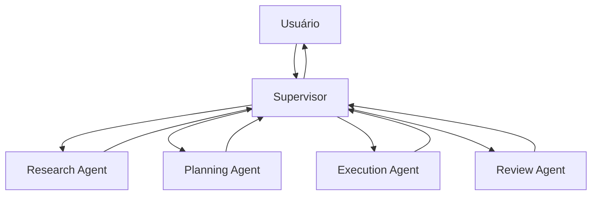
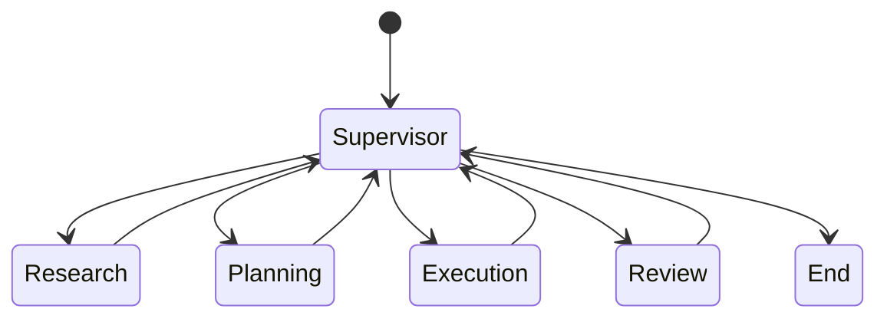

# Desafio 19 – Supervisor Agent, Coordenação, Delegação e Governança de Agentes Especializados

## Visão Geral

O Supervisor Agent é o componente central de uma arquitetura multiagente corporativa.

Enquanto os agentes especializados executam tarefas específicas, o Supervisor Agent é responsável por:

- Receber objetivos de negócio.
- Compreender contexto.
- Planejar a execução.
- Selecionar agentes.
- Delegar atividades.
- Consolidar resultados.
- Resolver conflitos.
- Monitorar desempenho.
- Aplicar governança.

Neste módulo construiremos a camada de coordenação da plataforma.

---

# Objetivos de Aprendizagem

1. Projetar um Supervisor Agent corporativo.
2. Implementar delegação de tarefas.
3. Controlar múltiplos agentes simultaneamente.
4. Resolver conflitos entre agentes.
5. Aplicar governança multiagente.
6. Integrar LangGraph, Replay Engine e Sandbox Runner.
7. Criar métricas operacionais para ecossistemas multiagentes.

---

# ADR-011 – Uso de Supervisor Central

## Decisão

Adotar um agente supervisor responsável pela coordenação.

## Benefícios

- Redução de complexidade.
- Melhor auditabilidade.
- Governança centralizada.
- Controle operacional.
- Orquestração previsível.

## Trade-offs

- Ponto central de decisão.
- Necessidade de monitoramento adicional.

---

# Problema Arquitetural

Sem um supervisor:

- Agentes competem por recursos.
- Há duplicidade de trabalho.
- O contexto se fragmenta.
- A observabilidade se torna difícil.

---

# Modelos de Coordenação

## Supervisor Model

```text
Supervisor
   |
   +-- Research Agent
   +-- Planning Agent
   +-- Execution Agent
   +-- Review Agent
```

## Swarm Model

Agentes decidem livremente.

## Hierarchical Model

Supervisores em múltiplos níveis.

Arquitetura inicial do projeto:

```text
Supervisor Model
```

---

# Responsabilidades do Supervisor

## Planejamento

Determinar:

- Objetivo.
- Estratégia.
- Sequência de execução.

## Delegação

Selecionar o agente adequado.

## Consolidação

Produzir resposta única.

## Governança

Aplicar políticas.

## Observabilidade

Registrar decisões.

---

# Arquitetura Geral



---

# Ciclo Operacional

1. Receber solicitação.
2. Classificar problema.
3. Selecionar agentes.
4. Delegar tarefas.
5. Coletar resultados.
6. Resolver inconsistências.
7. Consolidar resposta.
8. Registrar replay.

---

# Estratégias de Delegação

## Delegação Baseada em Especialidade

Exemplo:

- Pesquisa → Research Agent
- Ferramentas → Execution Agent

## Delegação Baseada em Carga

Escolher agente menos ocupado.

## Delegação Baseada em Confiança

Selecionar agente com melhor histórico.

---

# Resolução de Conflitos

Exemplo:

Research Agent conclui que incidente é de GPS.

Execution Agent conclui que incidente é de Banco.

Supervisor deve:

1. Reunir evidências.
2. Solicitar validações.
3. Acionar Review Agent.
4. Emitir decisão final.

---

# Integração com LangGraph

Supervisor torna-se o nó principal do workflow.



---

# Integração com Sandbox Runner

Todas as decisões do Supervisor devem ser executadas inicialmente em Sandbox.

Benefícios:

- Testabilidade.
- Segurança.
- Benchmark.

---

# Integração com Replay Engine

Registrar:

- Agente escolhido.
- Motivo da escolha.
- Resultado recebido.
- Decisão final.

---

# Integração com Memory Layer

Supervisor acessa:

- Histórico de execuções.
- Resultados anteriores.
- Conhecimento compartilhado.

---

# Governança Multiagente

## Políticas

- Limites de delegação.
- Limites de custo.
- Limites de ferramentas.

## Auditoria

Toda decisão crítica deve ser registrada.

---

# Human-in-the-Loop

Fluxo:

```text
Supervisor
   |
   v
Approver
   |
   v
Execution
```

Utilizado para ações críticas.

---

# Métricas Operacionais

Registrar:

- Tempo médio de coordenação.
- Agentes acionados.
- Taxa de retrabalho.
- Taxa de conflito.
- Custo por execução.

---

# Casos de Uso Corporativos

## Investigação de Incidentes

Coordenação de especialistas.

## Criação de Relatórios

Pipeline de pesquisa, redação e revisão.

## Operações de Campo

Coordenação de múltiplos domínios técnicos.

---

# Estrutura de Diretórios

```text
multiagent/
├── supervisor/
│   ├── policies/
│   ├── routing/
│   ├── governance/
│   └── metrics/
├── agents/
└── workflows/
```

---

# Exercício 1

Modelar responsabilidades do Supervisor.

---

# Exercício 2

Criar catálogo de agentes.

---

# Exercício 3

Implementar regras de delegação.

---

# Exercício 4

Implementar resolução de conflitos.

---

# Exercício Avançado

Projetar um Supervisor capaz de coordenar a investigação completa de um incidente crítico utilizando quatro agentes especializados.

---

# Estratégia de Testes

## Unitários

- Delegação.
- Roteamento.
- Governança.

## Integração

- Supervisor + LangGraph.
- Supervisor + Replay.

## E2E

- Fluxo multiagente completo.

---

# Critérios de Aprovação

- Supervisor modelado.
- Estratégias de delegação definidas.
- Integrações previstas.
- Observabilidade definida.
- Casos de uso documentados.

---

# Armadilhas Comuns

1. Concentrar lógica demais nos especialistas.
2. Criar supervisor excessivamente complexo.
3. Não registrar decisões.
4. Ignorar conflitos.
5. Não definir governança.

---

# Checklist

- Supervisor definido.
- Políticas definidas.
- Métricas definidas.
- Governança documentada.
- Integrações definidas.

---

# Perguntas de Revisão

1. Qual a principal responsabilidade do Supervisor?
2. Quando utilizar Human-in-the-Loop?
3. Como resolver conflitos?
4. Como medir eficiência do Supervisor?
5. Como LangGraph auxilia a coordenação?

---

# Relação com a Arquitetura Final

O Supervisor Agent será o principal ponto de coordenação da arquitetura multiagente corporativa.

---

# Próximo Módulo

Desafio 20 – Protocolos de Comunicação, Message Bus e Contratos entre Agentes.
