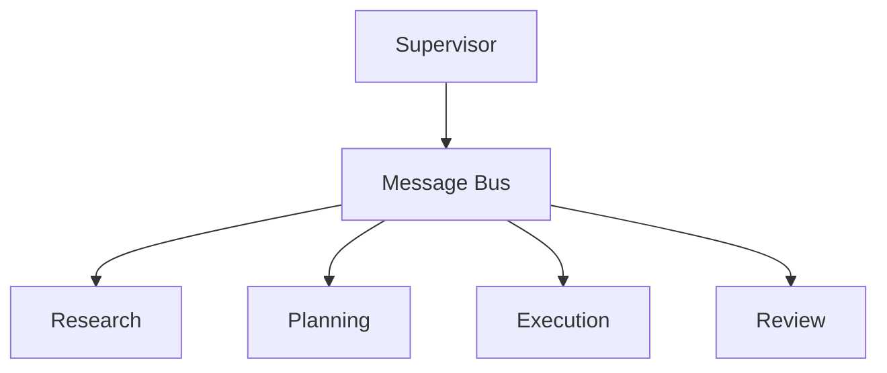
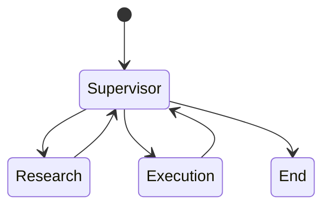

# Desafio 20 – Protocolos de Comunicação, Message Bus e Contratos entre Agentes

## Visão Geral

Após a criação da arquitetura multiagente e do Supervisor Agent, surge um novo desafio: como os agentes se comunicam de maneira confiável, auditável e escalável?

Este módulo define a camada de comunicação da plataforma.

Uma arquitetura multiagente sem protocolos bem definidos rapidamente se transforma em um sistema difícil de manter.

O objetivo deste módulo é criar padrões formais para troca de mensagens, compartilhamento de contexto, eventos e coordenação.

---

# Objetivos de Aprendizagem

1. Definir protocolos de comunicação entre agentes.
2. Implementar contratos padronizados.
3. Compreender Message Bus.
4. Projetar comunicação síncrona e assíncrona.
5. Integrar Replay Engine.
6. Integrar Observability Layer.
7. Escalar arquiteturas multiagentes.

---

# ADR-012 – Comunicação Padronizada

## Decisão

Toda comunicação entre agentes deverá utilizar contratos formais.

## Benefícios

- Interoperabilidade.
- Auditoria.
- Baixo acoplamento.
- Evolução independente.

---

# Problema Arquitetural

Sem protocolos definidos:

- Mensagens se tornam inconsistentes.
- Agentes dependem do formato interno uns dos outros.
- Replay torna-se complexo.
- Observabilidade fica limitada.

---

# Arquitetura de Comunicação

```text
Supervisor
     |
     v
Message Bus
     |
 +---+---+---+
 |   |   |   |
 R   P   E   V
```

Legenda:

- R = Research Agent
- P = Planning Agent
- E = Execution Agent
- V = Review Agent

---

# Tipos de Comunicação

## Request/Response

Fluxo síncrono.

```text
Agent A -> Request
Agent B -> Response
```

## Event Driven

Fluxo assíncrono.

```text
Agent A -> Event
Multiple Agents consume
```

---

# Contrato de Mensagem

```json
{
  "message_id":"",
  "timestamp":"",
  "sender":"",
  "receiver":"",
  "type":"request",
  "payload":{}
}
```

Campos obrigatórios:

- message_id
- correlation_id
- sender
- receiver
- type
- payload

---

# Correlation ID

Objetivo:

Correlacionar mensagens pertencentes à mesma execução.

Exemplo:

```text
INCIDENT-2026-001
```

---

# Message Bus

## Responsabilidades

- Entrega de mensagens.
- Registro de eventos.
- Roteamento.
- Auditoria.

## Não Responsabilidades

- Tomar decisões.
- Executar regras de negócio.

---

# Arquitetura do Message Bus



---

# Protocolos de Comunicação

## Protocol 1 – Task Assignment

Supervisor delega trabalho.

## Protocol 2 – Result Submission

Agente retorna resultado.

## Protocol 3 – Clarification Request

Agente solicita contexto adicional.

## Protocol 4 – Escalation

Agente sinaliza bloqueio.

---

# Integração com Replay Engine

Toda mensagem deve gerar evento.

```json
{
  "event":"message_sent",
  "agent":"planning_agent"
}
```

---

# Integração com LangGraph

Cada troca de mensagens corresponde a uma transição explícita.



---

# Integração com Sandbox Runner

As mensagens devem ser registradas integralmente durante homologação.

Benefícios:

- Auditoria.
- Benchmark.
- Replay.

---

# Observabilidade

Registrar:

- origem
- destino
- tipo
- duração
- erros
- tamanho do payload

---

# Estratégias de Escalabilidade

## Broadcast

Uma mensagem para múltiplos agentes.

## Directed Routing

Mensagem para agente específico.

## Queue Based

Mensagens consumidas conforme disponibilidade.

---

# Tratamento de Falhas

## Timeout

Agente não respondeu.

## Retry

Nova tentativa.

## Escalation

Supervisor assume controle.

---

# Casos de Uso Corporativos

## Investigação de Incidente

Supervisor distribui tarefas.

## Geração de Relatório

Pesquisa, redação e revisão ocorrem em paralelo.

## Atendimento Operacional

Agentes especializados colaboram para responder solicitações.

---

# Estrutura de Diretórios

```text
multiagent/
├── messaging/
│   ├── contracts/
│   ├── protocols/
│   ├── events/
│   └── bus/
├── agents/
└── orchestration/
```

---

# Exercício 1

Definir contrato padrão de mensagens.

---

# Exercício 2

Implementar Correlation ID.

---

# Exercício 3

Modelar Message Bus.

---

# Exercício 4

Registrar mensagens no Replay Engine.

---

# Exercício Avançado

Projetar um protocolo completo para investigação de incidentes envolvendo quatro agentes especializados trabalhando simultaneamente.

---

# Estratégia de Testes

## Unitários

- contratos
- validação de mensagens

## Integração

- Message Bus
- Supervisor
- Agentes

## E2E

- fluxo completo multiagente

---

# Critérios de Aprovação

- Contratos definidos.
- Protocolos documentados.
- Integração com Replay prevista.
- Message Bus modelado.

---

# Armadilhas Comuns

1. Mensagens sem versionamento.
2. Ausência de correlation_id.
3. Acoplamento entre agentes.
4. Falta de auditoria.
5. Protocolos ambíguos.

---

# Checklist

- Contratos criados.
- Protocolos definidos.
- Message Bus modelado.
- Observabilidade prevista.
- Integração documentada.

---

# Perguntas de Revisão

1. Qual a função do Message Bus?
2. O que é Correlation ID?
3. Quando utilizar eventos assíncronos?
4. Como integrar Replay Engine?
5. Como reduzir acoplamento entre agentes?

---

# Relação com a Arquitetura Final

Este módulo estabelece a fundação da comunicação multiagente corporativa e será utilizado em todos os desafios subsequentes.

---

# Próximo Módulo

Desafio 21 – Shared Memory, Context Federation e Compartilhamento de Conhecimento entre Agentes.
